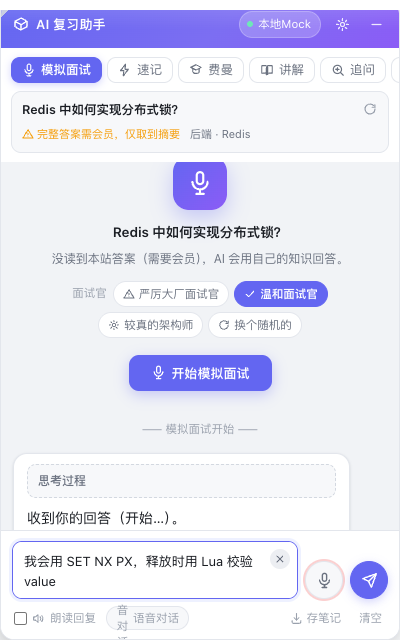
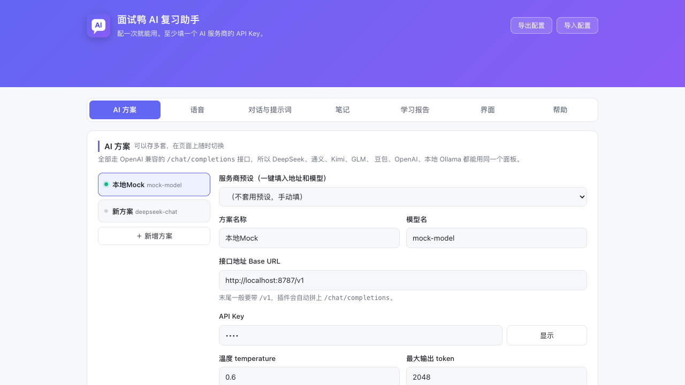

# 面试鸭 AI 复习助手

给 [面试鸭](https://www.mianshiya.com/) 加一个会跟你对话的 AI 陪练。它是个浏览器扩展，
不需要改动面试鸭本身，装上就能用。

打开任意一道题，页面右下角会出现一个悬浮球。点开就是一个 AI 面板：**它当面试官提问，
你开口回答，它给你打分、指出漏掉的点、然后继续追问下一题**。整个过程可以全程不动键盘。



---

## 功能一览

**复习模式（7 种）**

| 模式 | 做什么 |
|---|---|
| 🎤 模拟面试 | 它当面试官提问，你回答，它给评分 + 答对的点 + 漏掉的点，然后继续追问 |
| ⚡ 速记 | 一句话结论 + 一个记得住的类比或口诀 + 三个关键词，全文 250 字内 |
| 🎓 费曼 | 它只提问不替你讲，一步步逼你自己把知识点讲出来 |
| 📖 讲解 | 把这题讲透，列出面试官最想听的得分点 |
| 🔍 追问 | 像面试官一样层层追问，逼出盲区 |
| 🃏 自测 | 出题考你，**选择题直接点 A/B/C/D / 判断题点对错** |
| 💬 自由对话 | 把当前题当上下文的普通聊天 |

**语音**

- 🎙 **语音对话模式** —— AI 念完自动开始听你说话，你说完自动发送、它自动念出新回复，一轮接一轮不用碰键盘；你**一开口它就停止朗读**（云端引擎）
- 两种识别引擎随时切：浏览器内置（零配置）/ 云端转写（准、自带标点）
- 说完停顿自动结束（内置 1.5 秒 / 云端可调），也可以设成只手动停
- 朗读时**边生成边按句念**，代码块跳过不念

**记忆与统计**

- 🧠 **间隔重复**（SM-2 简化版）：每答完一题自评「完全不会 / 有点模糊 / 记住了 / 太简单」，到期的题会自己回来找你
- 📊 **学习报告**：今日刷题量、累计刷题量、最近两周趋势图、掌握度分布、**薄弱知识点排行**（按标签 / 题库 / 速记关键词 / 你自己的分类聚合）
- 🤖 **AI 诊断**：把这堆统计交给 AI，让它指出最该补的方向并给出接下来三天的安排
- 🗺 **思维导图**：按题库 / 标签 / 自定义分类生成可折叠的导图，点题目直接打开原题
- 🎯 **限定面试范围**：在报告里点「针对它出题」，之后模拟面试只考那个方向，并优先考你没掌握的题

**本地资料**

- 📝 **存笔记**：题目、题号、难度、所属题库、标签、本站参考答案、完整问答记录，整理成 Markdown 存到本地文件夹
- 可以**按题库 / 标签 / 难度 / 你自己的分类分成多个文件夹导出**
- 复习记录也存在浏览器本地，刷新、切题都不丢；设置页能搜索、筛选、展开看每一轮的完整回答

**其它**

- 🎨 代码块**语法高亮**（Go/Java/Python/JS/TS/Rust/SQL/Shell 等十几种），公式用轻量 LaTeX 渲染
- 📋 站点禁止复制也不影响插件里的复制按钮
- 🔌 兼容 OpenAI 格式的任意服务商，可存多套方案随时切

---

## 为什么是这个形态

面试鸭是别人的网站，没法改它的代码。所以选浏览器扩展：**只读取你自己浏览器里已经渲染出来的内容**，
不碰它的数据库，也不调它需要会员权限的接口。

有一条边界是刻意守住的：**不绕过会员墙**。答案如果是会员内容，插件只读你屏幕上已经显示出来的部分；
读不到就如实告诉你，并让 AI 用它自己的知识来讲。这样既不会让你的账号有风险，也符合站点规则。

---

## 快速开始

### 1. 装扩展

> 第一次装、或者想看更新和卸载步骤，看完整的 **[安装手册](INSTALL.md)**。

1. 打开 Chrome 或 Edge，地址栏输入 `chrome://extensions`（Edge 是 `edge://extensions`）
2. 打开右上角的**开发者模式**
3. 点**加载已解压的扩展程序**
4. 选中一个**文件夹** —— 就是本项目这个文件夹，或者 `打包.command` 生成的
   `dist/面试鸭AI复习助手`（推荐用后者，里面只有运行时需要的文件）
5. 首次安装会自动打开设置页

> **注意**：第 4 步要选文件夹，**不能选 zip**。Chrome 不会自动解压，
> 直接选 zip 会报「清单文件丢失或不可读取」。拿到 zip 的话先双击解压出文件夹再选。

打包时会同时产出两样东西：

| 产物 | 用途 |
|---|---|
| `dist/面试鸭AI复习助手/` | 直接拿去「加载已解压的扩展程序」 |
| `面试鸭AI复习助手-v0.1.0.zip` | 分享给别人（对方需先解压） |

### 2. 配一个 AI

在设置页的「AI 方案」里：

1. 从「服务商预设」里选一家（比如 DeepSeek）
2. 把 API Key 粘进去
3. 点**测试连接**，看到绿字就成功了

点「保存」时 Chrome 会弹窗问是否允许扩展访问该网站，**必须点允许**，否则请求发不出去。

设置页长这样（可以存多套方案随时切换）：



### 3. 开始复习

打开任意一道题，比如 [Redis 中如何实现分布式锁？](https://www.mianshiya.com/question/1780933295660363778)，
点开右下角悬浮球，选「🎤 模拟面试」，然后点开始。

---

## 功能

### 七种复习模式

见上面的「功能一览」。每个模式的提示词都能在设置页改。

每个模式的提示词都能在设置页改。模板里有 `{title}`（题目）和 `{reference}`（页面上的参考答案）
两个占位符，AI 的回答会参考本站答案，更贴合面试鸭的口径 —— 也可以在设置里关掉，让它完全靠自己的知识。

会话按「题目 + 模式」分别保存，切模式不丢上下文，翻回上一题对话还在。

### 选择题直接点，不用打字

AI 出的选择题会被解析成 **A / B / C / D 按钮**，点一下就作答；判断题给「对 / 错」两个按钮；
面试和自测模式下还常驻一个「不会」——不想答了直接跳过看答案。

解析判据收得比较紧（字母必须从 A 连续、每个选项独占一行），免得正文里随便一个「A. 」被当成选项。

### 换个面试官，体感完全不一样

模拟面试和追问模式下，开始前可以挑一个面试官人设：

| 人设 | 风格 |
|---|---|
| **严厉大厂面试官** | 答得含糊会当场打断，不接受「大概」「应该」，追问到你答不上来 |
| **温和面试官** | 先肯定你答对的地方，再引导你自己补上遗漏 |
| **较真的架构师** | 只问边界和规模：「流量放大一百倍呢」「机器挂了一半呢」 |
| **换个随机的** | 每道题随机抽一个，避免习惯某一种提问方式 |

人设会加在提示词最前面，所以你自己改过的模式提示词照样生效。

### 语音

**说话输入**（两种引擎，设置页一键切换）：

- **浏览器内置识别** —— 零配置零成本，说完立刻出字。缺点是 Chrome 走 Google 服务器，
  国内通常连不上（会提示 network 错误）；**Edge 走微软服务器，国内可以直连**。
- **云端转写** —— 录完整段音频再发给语音转写接口，准确率高、自带标点、不挑网络。
  支持任何 OpenAI 兼容的转写服务（硅基流动 SenseVoice / Groq Whisper / OpenAI Whisper / 本地 faster-whisper）。

**静音自动断句**：说完停顿约 1.2 秒自动结束录音，不用手动按停。阈值可调。
打开「识别完自动发送」后，整个模拟面试可以完全不动键盘。

**让 AI 念出来**：用系统自带语音，免费可离线。会**边生成边按句朗读**，不用等整段写完；
代码块会用「（代码块）」带过，不念 `**` 和反引号。

### 本地笔记：攒下你自己的复习资料

点面板底部的**存笔记**，就把这道题的**题目、标签、本站参考答案、刚才的对话**整理成一份 Markdown，
存到本地的这个位置：

```
<浏览器下载目录> / 面试鸭笔记 / Redis 中如何实现分布式锁？.md
```

- 一道题一个文件，再存一次是**覆盖更新**同一份，不会堆一堆副本
- 纯文本，可以直接拖进 Obsidian、Typora、VS Code 或者你自己的笔记库
- 在设置页打开**自动更新**，每轮 AI 回答后文件会自己刷新，不用手动点
- 每轮对话同时会记在浏览器本地，刷新页面、切题都不会丢；设置页可以**一次性导出全部笔记**成一份汇总（带目录）

想换存放位置就去 `chrome://settings/downloads` 改「下载位置」，或者设成「每次询问」，每存一次自己选目录。

文件名里的非法字符（`/ \ : * ? " < > |`）、Windows 保留名、超长标题都会自动处理，
不会因为题目里带个问号就存不下来。

### 支持的 AI 服务商

全部走 OpenAI 兼容的 `/chat/completions`，所以只要接口兼容就能接。内置一键预设：

| 服务商 | 说明 |
|---|---|
| **DeepSeek** | 中文强、便宜，充 10 元能用很久，新手首选 |
| **硅基流动** | 有免费额度；**同一个 Key 能同时做对话和语音转写**，最省事 |
| 阿里云百炼（通义千问） | 新用户有免费 token |
| 月之暗面 Kimi | 长上下文见长 |
| 智谱 GLM | `glm-4-flash` 有免费版本 |
| 火山方舟（豆包） | 模型名要填接入点 ID |
| 腾讯混元 / 百度千帆 | — |
| OpenAI / OpenRouter | 国内需要代理 |
| **SSNH 中转（Qwen3-27B）** | 内置预设。这是个推理模型，默认会先想一大段再回答，预设里已经帮你关掉思考链 |
| **Ollama / LM Studio（本地）** | 完全免费离线，不需要 Key |
| 自定义 / 中转站 | 填任何 OpenAI 兼容地址 |

可以保存多套方案随时切换，比如「平时用 DeepSeek，难题切 GPT」。

**自定义请求参数**：每个方案都能额外填一段 JSON，原样合并进请求体。用来应付各家的小差异 ——
比如 Qwen3、GLM-Z 这类推理模型默认会先花上千 token 想一遍再回答，填上
`{"chat_template_kwargs":{"enable_thinking":false}}` 就能关掉思考链，快很多也省很多。
（`model` / `messages` / `stream` 不允许被覆盖，防止手滑把请求弄坏。）

### 快捷键

| 快捷键 | 作用 |
|---|---|
| `Alt`+`Shift`+`M` | 显示 / 隐藏面板 |
| `Alt`+`Shift`+`V` | 开始 / 停止语音输入 |
| `Alt`+`Shift`+`A` | 打开扩展菜单 |
| `Enter` | 发送（可改成 `Ctrl/⌘`+`Enter`） |
| `Shift`+`Enter` | 换行 |

冲突的话到 `chrome://extensions/shortcuts` 改。

---

## 常见问题

**点麦克风提示「连不上浏览器语音识别服务」**
国内 Chrome 的固有问题，它的内置识别要用 Google 服务器。两个办法：换 Edge 浏览器，或者到设置页把语音引擎切成「云端转写」。

**提示「网络请求发不出去」**
多半是没给域名授权。回到「AI 方案」重新点一次「保存」，Chrome 弹窗时选「允许」。也可能是该服务需要代理。

**提示「API Key 被拒绝」**
检查 Key 有没有复制全（前后别带空格）、账户有没有欠费、对应模型有没有开通。

**一直显示「答案被会员墙挡住」**
这是正常的。完整答案在面试鸭是会员内容，插件不绕过它，只读你屏幕上已经渲染出来的部分。这种情况下 AI 会用自己的知识来讲解和打分，面板上会标出来源。

**打开开发者工具后页面变成空白**
面试鸭页面里带了反调试脚本，检测到 DevTools 就会把页面替换成 `about:blank`（控制台会打 `You don't have permission to use DEVTOOL!`）。这是站点自身的行为，**和本扩展无关**，正常使用不打开开发者工具就不会触发。

**AI 回答被截断**
到「AI 方案」把「最大输出 token」调大。用了推理模型（Qwen3、GLM-Z 之类）尤其要注意：思考链会吃掉大量额度，
可能一个字都没答就截断了。填上前面说的 `enable_thinking: false` 或者把 token 调到 4096 以上。

**笔记存到哪儿了**
浏览器下载目录下的「面试鸭笔记」文件夹里。面板保存成功时状态栏会显示完整相对路径。
想换位置见上面「本地笔记」那节。

**录音时会把我删掉的字又填回来吗**
不会了。识别结果只在输入框归你「没动过」时才自动写入；你一旦自己编辑过（包括删空），
后续识别结果就改成插到光标位置，不会再覆盖你的内容。

---

## 隐私

- API Key 只存在本机浏览器的 `chrome.storage.local` 里，**不会同步到 Google 账号**，不经过任何中间服务器。
  扩展源码里**不含任何 Key**，所以把打包好的 zip 发给别人不会泄露你自己的凭证。
- 只有你点发送时，题目和对话内容才会直接发给你自己配置的那家 AI 服务商。
- 录音只在你本机处理，直接发给你配置的转写服务，不上传到别处。
- 复习记录也只存在浏览器本地；只有你点「存笔记」或开了自动更新，才会写成磁盘上的文件。
- 扩展不修改面试鸭的任何数据，也不调用它需要会员权限的接口。

> 「导出配置」出来的 JSON **是带 API Key 的**，方便你换电脑直接导入 —— 发人之前记得把 Key 删掉。

---

## 这一版修了什么

- **录音时删掉的字又被填回来**：识别结果以前每一帧都重写整个输入框，你手动删的内容下一次事件就回来了。
  现在你一旦自己编辑过输入框，写入权就交回给你，后续识别结果改成插到光标处。
- **标题栏的按钮点不动**：拖拽用的 pointer capture 会把事件从按钮手里抢走，
  导致设置和折叠按钮的点击永远不触发。现在按下按钮时会放行。
- **多余的「停止」按钮**：作者样式里的 `display` 会盖掉浏览器默认的 `[hidden]{display:none}`。
- **深色/浅色误判**：站点 body 背景是透明时以前会一律当成深色，现在会往上找 `html`，最后退回系统偏好。
- **拖拽面板会清空正在生成的回答**：任何配置写入都会触发消息区重绘，生成到一半的内容当场消失。
- **推理模型的思考链被丢掉**：各家字段名不统一（`reasoning_content` / `reasoning`），以前只认前者。
- **设置页「新增方案」报错**：用到的工具函数定义在内容脚本里，设置页加载不到。
- **导出文件名差一天**：用了 UTC 日期，东八区凌晨会算错。

前三条都是自动化测试或截图复查抓出来的 —— 它们只在实际渲染和真实交互里才会暴露。

---

## 项目结构

```
mianshiya-ai-review/
├── manifest.json          MV3 清单
├── background.js          服务线程：AI 请求代理 + SSE 流式转发 + 语音转写编排
├── offscreen.html/js      录音（让麦克风权限归属扩展自身）
├── options.html/css/js    设置页
├── popup.html/js          工具栏弹窗
├── shared/
│   ├── config.js          服务商预设、模式提示词、默认配置
│   └── store.js           配置读写与权限申请
├── content/
│   ├── util.js            通用小工具
│   ├── md.js              轻量 Markdown 渲染（重点支持代码块）
│   ├── extract.js         题目/答案抽取
│   ├── tts.js             流式逐句朗读
│   ├── asr.js             语音输入（内置 / 云端双引擎）
│   ├── ui.js              Shadow DOM 面板
│   └── main.js            编排层
└── dev/                   开发与测试工具（不随扩展分发）
```

**零构建**：纯 JS，没有打包步骤。改完代码在 `chrome://extensions` 点一下刷新就行。

---

## 开发与测试

```bash
# 跑全部测试（会自动起 mock 服务）：共 430+ 项
bash dev/run_tests.sh

# 或者分别跑
node dev/mock-openai-server.js      # 本地假的 OpenAI 兼容服务，测试用，不花钱
python3 dev/test_extract.py         # 抽取器专项：51 项
python3 dev/e2e_test.py             # 端到端：190 项
python3 dev/test_voice.py           # 语音链路：36 项

# 发布前跑一下：验证打包产物本身能装能用（会连真实站点）
python3 dev/verify_package.py       # 产物验证：20 项
```

`verify_package.py` 值得单独说一句：前面三套测试跑的都是源码目录，而这个脚本
先执行打包，再**原封不动**地加载 `dist/` 里那份产物，连真实站点确认能注入、能抓题 ——
它守的是「用户真正拿到手的那个东西」。

### 测试怎么做的

- **`dev/fixtures/`** 是抓下来的真实页面快照，剥掉了所有脚本（包括站点的反调试脚本），
  只保留 JSON-LD 结构化数据。自动化测试跑在这上面，确定、快、不怕站点改版。
- **真实站点只做冒烟测试**，必须在 2 秒内跑完 —— 因为站点的反调试脚本大约 2.7 秒后就会清空页面。
- **`dev/mock-openai-server.js`** 会说 OpenAI 的 SSE 流式协议，所以整条对话链路都能在
  不消耗任何 API 额度的前提下测到，包括「发给模型的 system prompt 是否正确」。
- **虚拟麦克风**：语音测试用 `--use-fake-device-for-media-stream` 加一段
  「2 秒说话 + 3 秒静音」循环的 WAV，验证录音、音量检测、静音断句、上传转写整条链路。

### 其它工具

```bash
python3 dev/capture_fixture.py      # 重新抓页面快照（站点改版后用它更新夹具）
python3 dev/inspect_dom.py          # 打印候选选择器命中的元素和文本，用来校准抽取规则
python3 dev/check_antidebug.py      # 复现站点的反调试行为，确认它是不是还在
```

### 抽取策略

题目抽取分三层降级，从最可靠到最兜底：

1. **JSON-LD**（`schema.org/QAPage`）—— 服务端渲染进 HTML 的结构化数据，最稳
2. **语义化类名** —— `.best-answer-view .markdown-body` 这类站点手写的类名
3. **正文启发式** —— 从主内容区取最像标题的元素

注意**不要用 `css-m4timi` 这类类名**：那是 Ant Design v5 的 cssinjs 编译产物哈希，
每次部署都会变。同理 `[data-node-key="bestAnswer"]` 是 antd 的标签按钮而不是面板，也不能当容器。

---

## 已知限制

诚实说明一下哪些地方没法自动化验证：

- **语音识别质量**取决于你选的服务和真实音频环境，测试用的是虚拟麦克风和模拟波形，
  验证的是链路正确性而不是识别准确率。
- **各家 AI 的实际输出质量**没法自动测。测试用的是 mock 服务，验证的是请求格式、
  上下文拼装和错误处理，不是模型答得好不好。
- **内置语音识别**没法在无头环境里测（依赖系统语音服务），只能保证错误提示清晰、
  能引导你切到云端方案。
- **站点改版**会让抽取失效。真发生了就跑 `dev/capture_fixture.py` 重新抓夹具、
  `dev/inspect_dom.py` 重新校准选择器，一般改几行常量就能修好。
